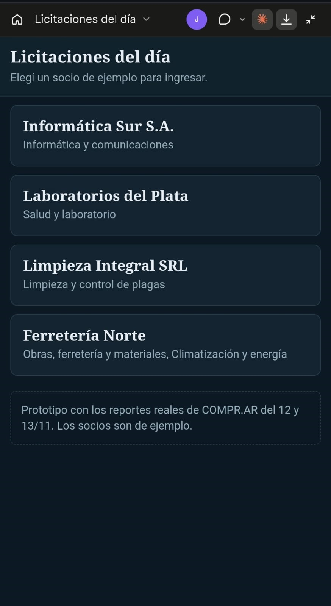
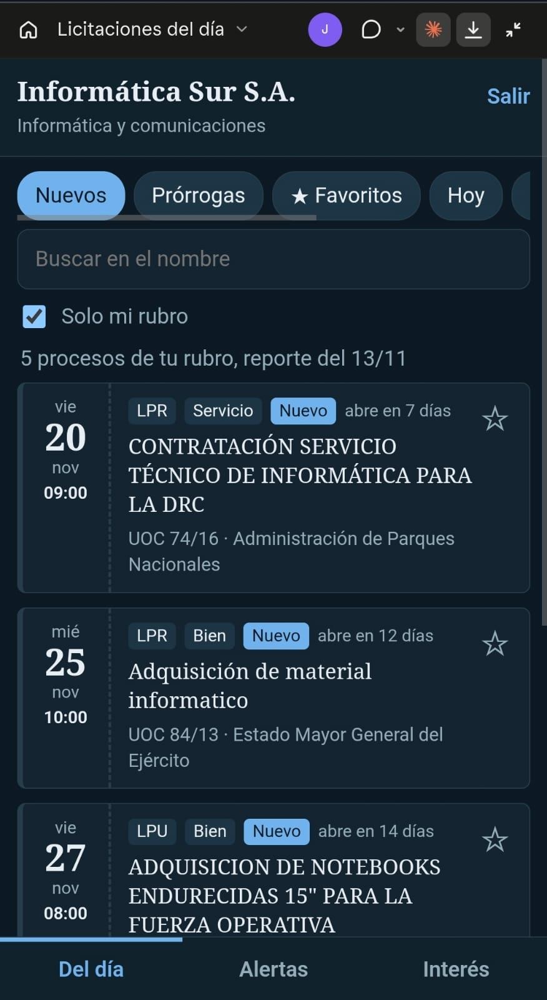
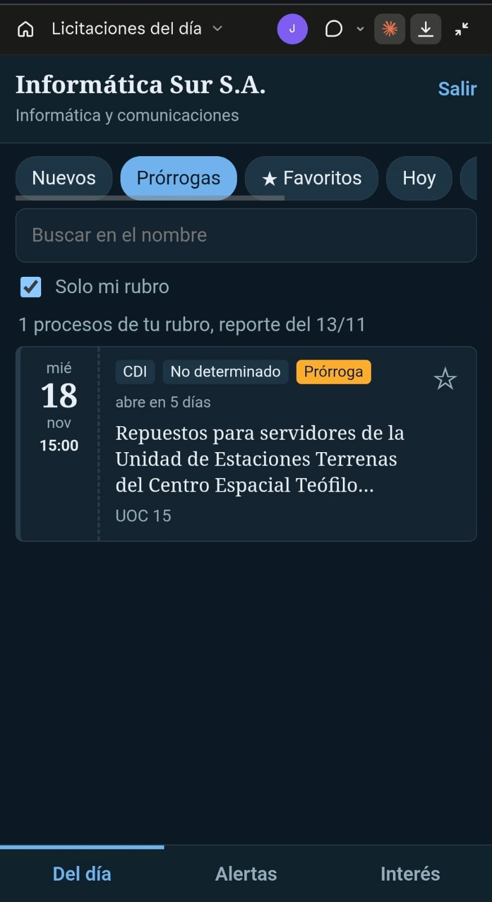
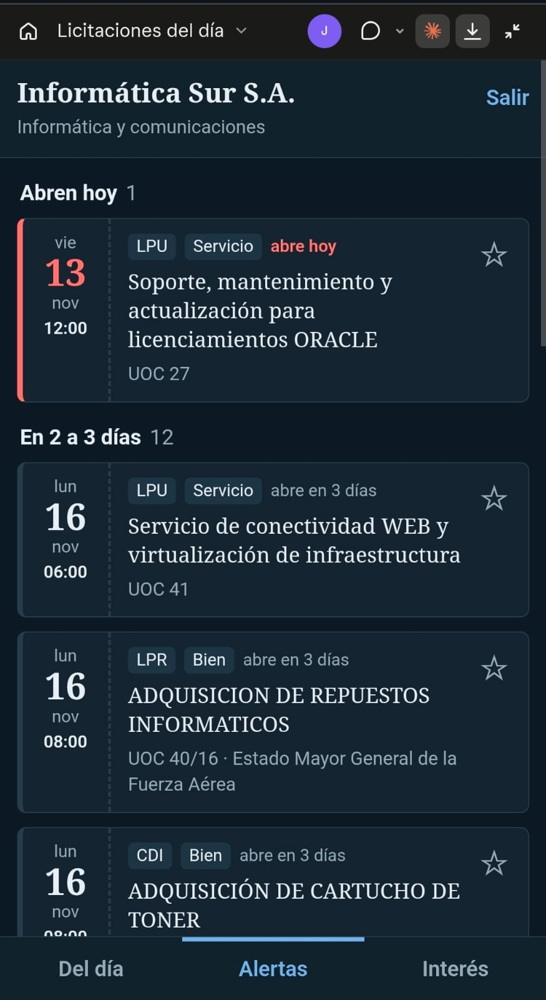
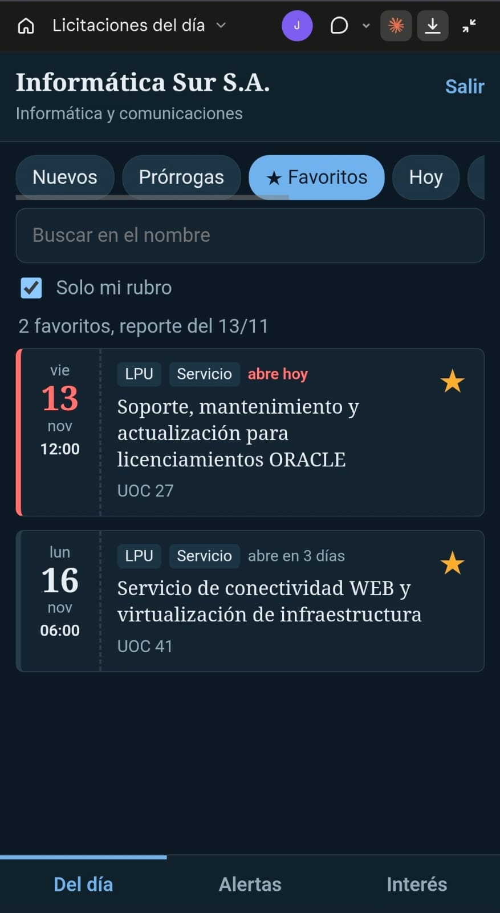
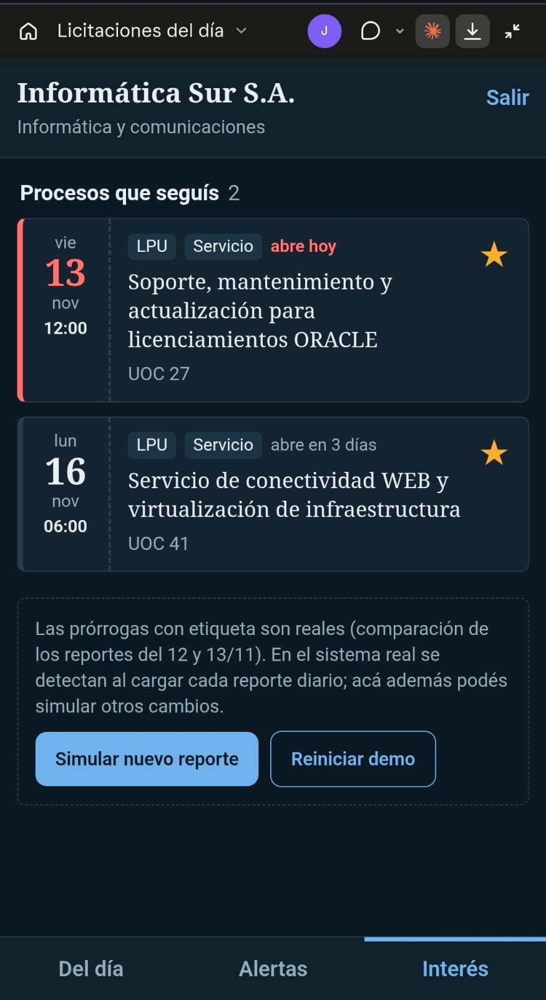

# Licitaciones del día: alertas por rubro en el celular

Prototipo de una app móvil que le muestra a cada proveedor las contrataciones públicas de **su rubro**, le avisa cuáles están por abrir y le informa cuando una licitación que le interesa **cambia de fecha**.

> **Estado:** primera versión / prototipo con datos de ejemplo. Este repositorio es una vitrina: contiene la descripción y las capturas del proyecto. El código fuente se mantiene en un repositorio privado.

## El problema

Los socios de una cámara empresaria reciben por email un listado de procesos de compra parecido al del portal oficial, sin filtrar. Tienen que revisar cientos de filas para encontrar las pocas que les sirven, y no se enteran si una apertura se prorroga.

## Qué hace la versión móvil

- **Ingreso por socio:** cada socio ve solo lo de su rubro.
- **Nuevos:** los procesos que aparecieron desde el reporte anterior.
- **Prórrogas:** procesos cuya fecha de apertura cambió, con la fecha anterior y la nueva.
- **Alertas:** lo que abre hoy, mañana o en los próximos tres días.
- **Favoritos con estrella:** el socio marca los procesos que le interesan y ve cuáles cambiaron.
- **Filtros y búsqueda:** Nuevos, Prórrogas, Favoritos, Hoy, Mañana, Esta semana y Todos; búsqueda por texto y opción de ver otros rubros.

## Capturas

<table>
  <tr>
    <td align="center"> Ingreso con socios de ejemplo</td>
    <td align="center"> Nuevos del rubro</td>
    <td align="center"> Prórrogas con el detalle del cambio</td>
  </tr>
  <tr>
    <td align="center"> Alertas de aperturas próximas</td>
    <td align="center"> Favoritos</td>
    <td align="center"> Cambios en los procesos seguidos</td>
  </tr>
</table>

## Cómo funciona

1. Se descarga cada día el reporte de procesos con apertura próxima del portal de compras públicas.
2. Se limpia y se enriquece: se separa el número de proceso, se estima el rubro y si es un bien o un servicio, y se calcula la urgencia.
3. Se guarda en **PostgreSQL** con historial diario.
4. Al cargar cada reporte se comparan los datos con el anterior para detectar procesos nuevos, prórrogas de apertura y procesos que salieron del listado.
5. Los perfiles de cada socio (rubros, palabras clave, exclusiones) generan su boletín y sus alertas.

Con tres reportes de noviembre de 2026 el sistema detectó 8 prórrogas de apertura y 30 procesos nuevos.

## Tecnologías

Python · pandas · PostgreSQL · SQLAlchemy · Streamlit · Altair · HTML y JavaScript (prototipo móvil) · API de lenguaje natural para consultas en castellano (opcional)

## Datos

Los procesos provienen del listado público de **COMPR.AR**, el portal de compras públicas de la República Argentina. Los socios que aparecen en las capturas son ficticios. Es un proyecto independiente, sin relación oficial con la Oficina Nacional de Contrataciones. El rubro y la clasificación entre bien y servicio son estimaciones hechas a partir del nombre del proceso, no datos oficiales.

## Próximamente

Una versión para PC con tablero de gráficos, calendario de aperturas, buscador, tendencias y consulta en lenguaje natural.

